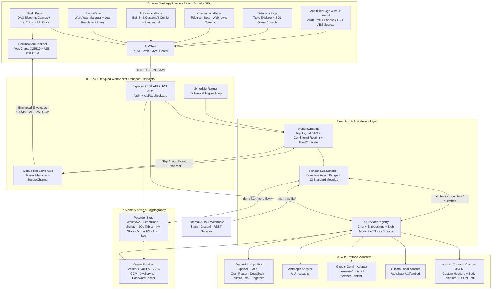
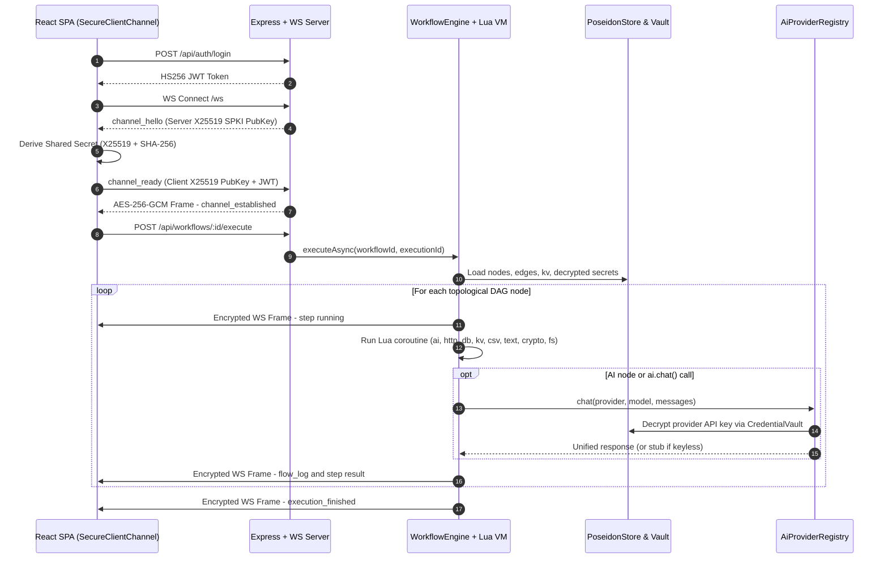

# Poseidon — Web Automation & Lua Workflow Platform

Poseidon is a **web-based n8n-style workflow automation platform** powered by a sandboxed **Lua runtime (Fengari)**, **multi-provider AI routing (with full Custom Provider support)**, an **integrated SQL database & persistent KV store**, and an **end-to-end encrypted WebSocket channel (X25519 ECDH + AES-256-GCM)**.

> **Platform note:** This repository hosts the **Website Version** of Poseidon — a full-stack TypeScript/React SPA (`Vite` + `React 18`) backed by an `Express` + `WebSocket` + `Fengari Lua` server.

---

## Key Capabilities

- **Dual-Mode Studio (`Studio`):**
  - **Visual Blueprint Mode (n8n-style DAG):** Drag-and-drop 16 node types onto a zoomable/pannable canvas, wire conditional edges (`on_success`, `on_error`, `always`), auto-layout graphs, and watch live node-by-node status telemetry.
  - **Standalone Lua Code Mode:** Write, test, and schedule standalone Lua automation scripts with an interactive **Lua API Reference** drawer and example template loader.
- **Multi-Provider AI Gateway & Custom Providers (`AI Providers`):**
  - Built-in adapters for **OpenAI**, **Anthropic (Claude)**, **Google Gemini**, **Groq**, **OpenRouter**, **DeepSeek**, **Mistral AI**, **xAI (Grok)**, **Together AI**, **Cohere**, **Ollama (Local)**, and **Azure OpenAI**.
  - **Custom Provider Option:** Connect any self-hosted or proprietary LLM gateway (`vLLM`, `LiteLLM`, `LM Studio`, `llama.cpp`, or custom HTTP/JSON endpoints) with configurable protocol format (`openai_compatible`, `anthropic`, `gemini`, `ollama`, `azure_openai`, `cohere`, `custom_json`), custom auth headers/query params, custom request body templates, and JSON response path extraction — or pass inline config directly inside Lua!
  - All provider API keys are encrypted at rest with **AES-256-GCM** and gracefully fall back to deterministic stub mode when unconfigured.
- **Rich Sandboxed Lua Runtime:**
  - 14+ built-in namespaces: `ai`, `connections`, `secrets`, `http`, `db`, `kv`, `csv`, `text`, `encoding`, `crypto`, `fs`, `json`, `flow`, `notify`, `mail`.
  - Dangerous host primitives (`io`, `os`, `package`, `loadfile`, `dofile`) are stripped; execution supports timeouts and immediate user abort via `AbortSignal` hooks.
- **Connections & Secrets Manager (`Connections` & `Vault`):**
  - Dedicated **Connections** tab to save Telegram Bot tokens (with `getMe` test & webhook setup helper), Slack/Discord/generic webhooks, GitHub tokens, API keys, and custom key-value secrets encrypted with **AES-256-GCM**.
  - Saved connections are automatically available inside any Lua script via `connections.get(name)`, `connections.token(name)`, `connections.url(name)`, `connections.find(category)`, `secrets.get(name)`, and `context.secrets[name]`.
- **Scripts & Templates Library (`Scripts`):**
  - Manage saved workflows and scripts (`Run`, `Stop`, `Edit`, `Clone`, `Pause/Activate`, `Execution Logs`, `Delete`) plus browse and create reusable **Lua Script Templates**.
- **Integrated Database & SQL Console (`Database`):**
  - Inspect system tables (`workflows`, `ai_providers`, `kv_store`, `executions`, `audit_log`, etc.), create custom tables, manage rows, and run SQL (`SELECT`, `INSERT`, `UPDATE`, `DELETE`, `CREATE TABLE`, `SHOW TABLES`, `COUNT(*)`).
- **Security & Telemetry (`Vault` & `Audit & Files`):**
  - PBKDF2-HMAC-SHA256 password hashing (`210,000` iterations), HS256 JWT authentication, AES-256-GCM encrypted Credential Vault (`context.secrets`), sandboxed virtual filesystem (`fs.*`), webhook triggers (`/api/webhooks/:id`), and real-time audit logging.

---

## System Architecture



### Encrypted Execution & AI Routing Flow



---

## Project Structure

```text
Poseidon/
├── index.html                          # SPA HTML entry point
├── package.json                        # Scripts & dependencies (Express, React, Vite, Fengari, ws)
├── tsconfig.json                       # Shared TypeScript config
├── vite.config.ts                      # Vite dev/build config
├── .env.example                        # Environment variable template
├── server.ts                           # Express API, JWT middleware, WS server, scheduler, Vite integration
├── server/
│   ├── aiProviders.ts                  # Multi-provider AI gateway, presets, custom endpoints & wire adapters
│   ├── connections.ts                  # Encrypted Connections registry (Telegram bots, webhooks, API tokens)
│   ├── crypto.ts                       # AES-256-GCM, X25519 ECDH, PBKDF2-HMAC-SHA256, HS256 JWT, SecureChannel
│   ├── luaEngine.ts                    # Sandboxed Fengari Lua VM + coroutine async bridge + 13 Lua modules
│   ├── sessionManager.ts               # Active encrypted WebSocket session registry & broadcaster
│   ├── store.ts                        # In-memory store (workflows, templates, KV, SQL engine, FS, audit log)
│   └── workflowEngine.ts               # DAG topological executor, conditional routing, AbortController
├── scripts/
│   └── examples/                       # Standalone Lua automation examples
│       ├── ai_summary.lua
│       ├── ai_multi_provider.lua
│       ├── ai_custom_provider.lua
│       ├── ai_embeddings.lua
│       ├── csv_etl_pipeline.lua
│       ├── crypto_aes_vault.lua
│       ├── db_query.lua
│       ├── http_get.lua
│       ├── http_request_crud.lua
│       ├── kv_state_cursor.lua
│       ├── text_template_report.lua
│       └── webhook_hmac_verify.lua
└── src/
    ├── types/fengari.d.ts              # TypeScript declarations for Fengari
    └── client/
        ├── App.tsx                     # Root SPA shell, navigation & encrypted WS event handler
        ├── api.ts                      # Typed REST API client
        ├── types.ts                    # Shared frontend models, node palette & Lua API docs metadata
        ├── styles.css                  # Dark studio theme
        ├── crypto/
        │   └── secureClientChannel.ts  # Browser RFC 7748 X25519 + WebCrypto AES-256-GCM client
        └── components/
            ├── AIProvidersPage.tsx     # AI providers & Custom Provider configuration + prompt playground
            ├── AuditFilesPage.tsx      # Audit log viewer & sandboxed file editor
            ├── ConnectionsPage.tsx     # Telegram bot tokens, webhooks, API keys & custom secret connections
            ├── CredentialsModal.tsx    # AES-256-GCM secret vault modal
            ├── DatabasePage.tsx        # Table explorer & SQL query console
            ├── LoginPage.tsx           # Authentication & registration screen
            ├── ScriptsPage.tsx         # Saved workflows manager & Lua templates library
            └── StudioPage.tsx          # Visual DAG blueprint canvas, Lua editor & API docs modal
```

---

## Quick Start

### Prerequisites
- **Node.js** `20+` (tested on Node `v22.x`)
- **npm** `10+`

### Installation & Running

```bash
# 1. Install dependencies
npm install

# 2. (Optional) Configure environment variables
cp .env.example .env

# 3. Run in development mode (Express + Vite HMR on port 3000)
npm run dev
```

Or build and run in production mode:

```bash
npm run lint     # TypeScript type-check (tsc --noEmit)
npm run build    # Production Vite bundle -> dist/
npm start        # Serve production build via Express
```

Open `http://localhost:3000` in your browser.

### Default Login Credentials
- **Test Admin:** `testadmin` / `poseidon123` (or `POSEIDON_TEST_PASSWORD`)
- **Default Admin:** `admin` / `poseidon` (when `POSEIDON_ADMIN_PASSWORD_HASH` is unset)
- You can also register new accounts directly from the **Create Account** tab on the login page.

---

## AI Providers & Custom Provider Support

Open the **AI Providers** tab in the web UI to manage connections, set the default provider, test connectivity, and experiment in the Prompt Playground.

### Supported Built-in Providers

| Provider ID | Name | Wire Protocol | Default Base URL |
|---|---|---|---|
| `openai` | OpenAI | `openai_compatible` | `https://api.openai.com/v1` |
| `anthropic` | Anthropic (Claude) | `anthropic` | `https://api.anthropic.com/v1` |
| `gemini` | Google Gemini | `gemini` | `https://generativelanguage.googleapis.com/v1beta` |
| `groq` | Groq | `openai_compatible` | `https://api.groq.com/openai/v1` |
| `openrouter` | OpenRouter | `openai_compatible` | `https://openrouter.ai/api/v1` |
| `deepseek` | DeepSeek | `openai_compatible` | `https://api.deepseek.com/v1` |
| `mistral` | Mistral AI | `openai_compatible` | `https://api.mistral.ai/v1` |
| `xai` | xAI (Grok) | `openai_compatible` | `https://api.x.ai/v1` |
| `together` | Together AI | `openai_compatible` | `https://api.together.xyz/v1` |
| `cohere` | Cohere | `cohere` | `https://api.cohere.com/v2` |
| `ollama` | Ollama (Local) | `ollama` | `http://localhost:11434` |
| `azure_openai` | Azure OpenAI | `azure_openai` | `https://YOUR_RESOURCE.openai.azure.com/openai/deployments/YOUR_DEPLOYMENT` |

### Adding a Custom Provider

Click **+ Custom** in the **AI Providers** tab (or `POST /api/ai/providers`) to connect any custom endpoint such as **vLLM**, **LiteLLM**, **LM Studio**, **llama.cpp**, or a **proprietary HTTP JSON AI service**:

1. Set a **Display Name** and **Provider Slug ID** (e.g., `internal-vllm`).
2. Choose a **Protocol Format**:
   - `openai_compatible`, `anthropic`, `gemini`, `ollama`, `azure_openai`, `cohere`, or `custom_json`.
3. Configure **Base URL**, **Default Model**, **Auth Type** (`bearer`, `x-api-key`, `api-key`, `x-goog-api-key`, custom `header`, `query_param`, or `none`), **Custom Headers JSON**, **Extra Request Body JSON**, and **Response JSON Path** (for `custom_json`, e.g., `data.reply`).
4. Call it from any Lua node:

```lua
-- Call a saved custom provider by slug
local reply = ai.chat({
  provider = "internal-vllm",
  model = "llama-3.3-70b",
  system = "You are a concise engineering assistant.",
  messages = {
    { role = "user", content = "Summarize today's deployment logs." }
  }
})

-- Or pass an inline custom provider directly from Lua
local inlineReply = ai.chat({
  base_url = "https://my-gateway.internal/v1",
  api_format = "openai_compatible",
  api_key = context.secrets.custom_key and context.secrets.custom_key.value,
  headers = { ["X-Tenant"] = "poseidon" },
  model = "custom-model",
  prompt = "Analyze payload..."
})
```

---

## Lua Sandbox Standard Library Reference

Every Lua script runs inside an isolated Fengari VM (`return { run = function(context) ... end }`) with access to `context.inputs`, `context.node`, and `context.secrets` (from the AES-256-GCM Vault):

| Module | Functions | Description |
|---|---|---|
| **`ai`** | `ai.chat(req)`, `ai.complete(prompt, opts?)`, `ai.embed(input, opts?)`, `ai.providers()`, `ai.models(providerId?)` | Multi-provider chat completions, embeddings, and provider discovery |
| **`http`** | `http.get(url, headers?)`, `http.post(url, body, headers?)`, `http.put(...)`, `http.patch(...)`, `http.delete(...)`, `http.request(opts)` | Outbound HTTP/HTTPS client with query params, table auto-JSON serialization, and parsed `resp.json` |
| **`db`** | `db.query(sql, ...)`, `db.execute(sql, ...)`, `db.insert(tbl, row)`, `db.find(tbl, where?)`, `db.update(tbl, idOrWhere, patch)`, `db.delete(tbl, idOrWhere)`, `db.count(tbl)`, `db.tables()` | SQL queries and CRUD operations against Poseidon tables |
| **`kv`** | `kv.get(key)`, `kv.set(key, val, ttlSeconds?)`, `kv.delete(key)`, `kv.list(prefix?)` | Persistent cross-execution key-value store with optional TTL expiration |
| **`csv`** | `csv.parse(text, opts?)`, `csv.stringify(rows, opts?)` | RFC-4180 CSV parsing and serialization |
| **`text`** | `text.template(tpl, vars)`, `text.trim(s)`, `text.split(s, sep)`, `text.replace(s, a, b)`, `text.contains(s, sub)`, `text.slugify(s)`, `text.regex_match(s, pat, flags?)`, `text.regex_replace(s, pat, rep, flags?)` | Mustache-style `{{var}}` templating, regex matching/replacement, and string utilities |
| **`encoding`** | `encoding.base64_encode/decode`, `encoding.url_encode/decode`, `encoding.hex_encode/decode` | Base64, URL, and hexadecimal codecs |
| **`crypto`** | `crypto.sha256`, `sha512`, `md5`, `hmac_sha256`, `hmac_sha512`, `uuid`, `random_bytes`, `random_int`, `aes_encrypt`, `aes_decrypt`, `constant_time_equals` | Cryptographic digests, HMAC signatures, AES-256-GCM, and timing-safe comparisons |
| **`fs`** | `fs.read`, `fs.write`, `fs.append`, `fs.delete`, `fs.exists`, `fs.list`, `fs.read_json`, `fs.write_json`, `fs.stat` | Sandboxed virtual filesystem (path-traversal protected) |
| **`json`** | `json.encode(val)`, `json.decode(str)` | JSON serialization and parsing |
| **`flow`** | `flow.get`, `flow.set`, `flow.delete`, `flow.get_all`, `flow.log`, `flow.emit`, `flow.now`, `flow.unix_ms`, `flow.sleep(ms)`, `flow.assert`, `flow.env` | Workflow state sharing, WebSocket event emission, delays, and assertions |
| **`connections`** | `connections.get(name)`, `connections.token(name)`, `connections.url(name)`, `connections.secret(name)`, `connections.find(category)`, `connections.list(category?)` | Read saved Telegram tokens, webhooks, headers, and custom secrets from the **Connections** tab |
| **`secrets`** | `secrets.get(name)` | Read decrypted Vault or Connection secret tables directly from any script |
| **`notify`** | `notify.webhook(url, payload, headers?)`, `notify.slack(url, msg, blocks?)`, `notify.discord(url, content, embeds?)` | Webhook, Slack, and Discord alert dispatchers |
| **`mail`** | `mail.send({ to, subject, body })` | Notification mail logger/dispatcher |

---

## Example Scripts (`scripts/examples/`)

- `ai_summary.lua` — Summarize upstream text via AI chat
- `ai_multi_provider.lua` — Route prompts across providers with automatic fallback
- `ai_custom_provider.lua` — Call saved or inline custom AI endpoints
- `ai_embeddings.lua` — Generate embeddings (`ai.embed`) and rank documents via cosine similarity
- `telegram_ai_bot.lua` — Chat with Poseidon AI providers from Telegram (webhook + `getUpdates` polling, per-chat `kv` memory, slash commands)
- `csv_etl_pipeline.lua` — Parse CSV, filter active rows, and export CSV/JSON artifacts
- `webhook_hmac_verify.lua` — Verify HMAC-SHA256 signatures with `crypto.constant_time_equals` and deduplicate in `kv`
- `kv_state_cursor.lua` — Track persistent counters and incremental state across runs
- `text_template_report.lua` — Query `db.find` and render reports with `text.template`
- `http_get.lua` & `http_request_crud.lua` — Fetch and mutate REST endpoints with `http.get` / `http.request`
- `db_query.lua` — Parameterized SQL table queries
- `crypto_aes_vault.lua` — AES-256-GCM encryption/decryption and HMAC-SHA512 signing

---

## API Overview

- **Auth:** `POST /api/auth/login`, `POST /api/auth/register`, `GET /api/auth/me`, `GET /api/auth/info`
- **Workflows & Webhooks:** `GET/POST /api/workflows`, `PUT/DELETE /api/workflows/:id`, `POST /api/workflows/:id/clone`, `POST /api/workflows/:id/execute`, `POST /api/workflows/:id/stop`, `POST /api/webhooks/:id`
- **Scripts Library:** `GET/POST /api/scripts`, `DELETE /api/scripts/:id`
- **AI Providers:** `GET /api/ai/presets`, `GET/POST /api/ai/providers`, `PUT/DELETE /api/ai/providers/:id`, `POST /api/ai/providers/:id/default`, `POST /api/ai/providers/:id/test`, `POST /api/ai/chat`
- **Database & KV:** `GET/POST /api/db/tables`, `GET/DELETE /api/db/tables/:name`, `POST /api/db/query`, `GET /api/kv`, `DELETE /api/kv/:key`
- **Connections:** `GET /api/connections/presets`, `GET/POST /api/connections`, `PUT/DELETE /api/connections/:id`, `POST /api/connections/:id/test`, `POST /api/connections/:id/telegram/webhook-info`, `POST /api/connections/:id/telegram/set-webhook`
- **Vault, FS & Audit:** `GET/POST/DELETE /api/credentials`, `GET/POST/DELETE /api/fs`, `GET /api/audit`
- **Encrypted WebSocket:** `ws(s)://<host>/ws` (`channel_hello` -> `channel_ready` -> AES-256-GCM encrypted envelopes)
